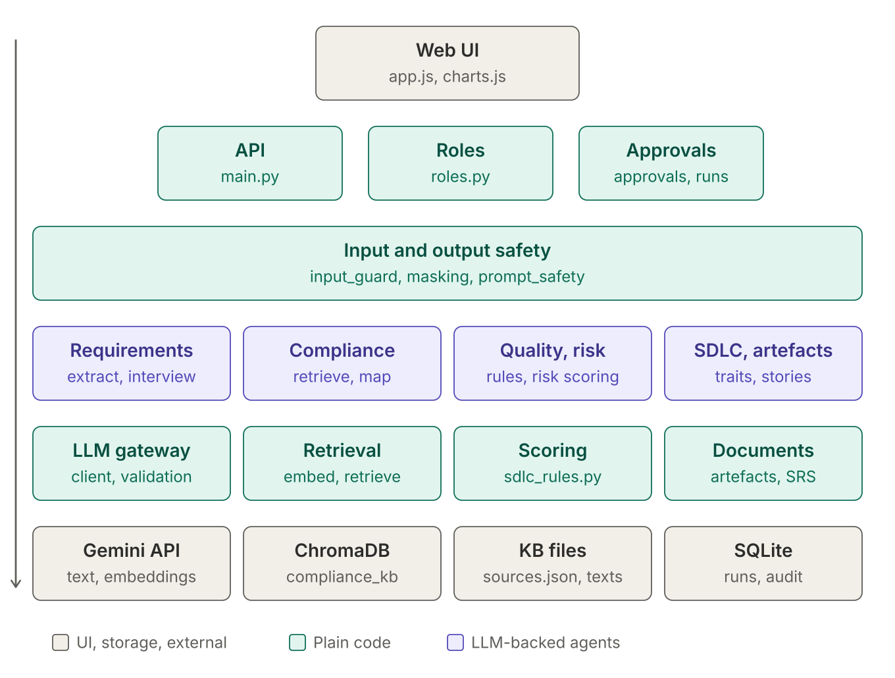
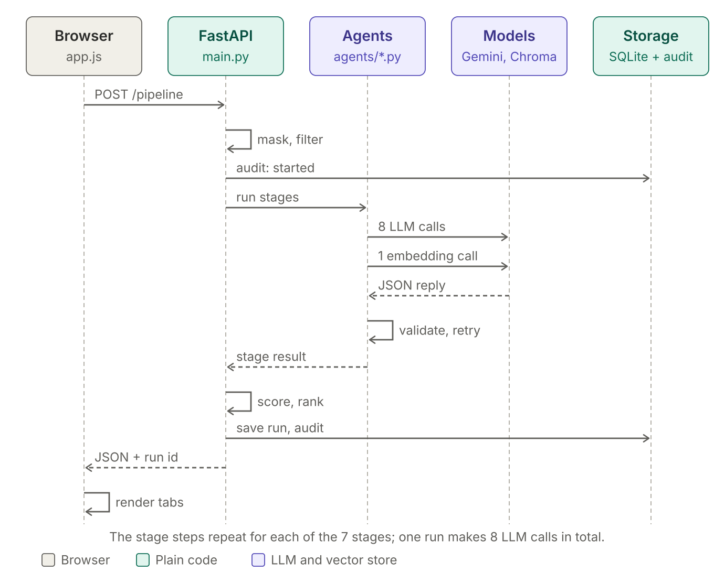
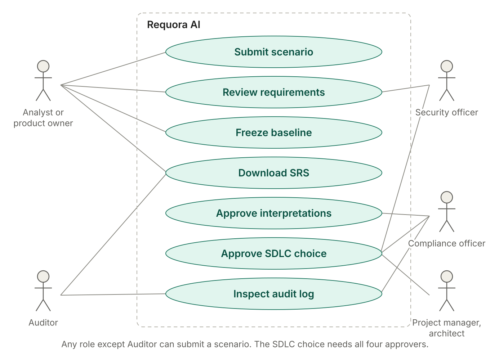

# Requora AI

An agentic AI assistant that turns a plain-language project scenario from a bank or other financial institution into a reviewed requirements package: requirements, regulation mapping, risks, an SDLC recommendation, a development workflow and a draft SRS. Every result is a proposal. People approve it.

Built for the Software Engineering course (NIT Karnataka, Surathkal) by Darshan.



## The idea in one rule

**The language model reads and writes. Plain code decides.**

The model extracts requirements, rates project traits and drafts text. It never chooses the SDLC model, sets a score, assigns an ID, grades a confidence level or approves anything. Those steps are ordinary Python that can be tested and explained.

## What you get from one run

| Output | How it is produced |
|---|---|
| Functional and non-functional requirements | LLM proposes; code checks that each one quotes your text word for word |
| Quality flags: vague wording, missing numbers, duplicates, conflicts | Code rules plus one LLM conflict check |
| Regulation mapping with evidence and confidence | Retrieval from a small knowledge base; code grades confidence and filters by domain |
| Risk register (5 to 8 risks) | LLM rates likelihood and impact from written rubrics; code scores and ranks |
| SDLC recommendation among 7 models, with a close-call flag | LLM rates 15 traits; code scores against fixed model profiles |
| Development workflow | Fixed template per model; the LLM can only add items linked to real requirements |
| User stories, use cases, process workflows, data and interface requirements | LLM drafts; code assigns IDs and links sources |
| Traceability matrix, compliance-control matrix, assumptions, open issues | Built by code |
| 17-section SRS (Markdown and printable HTML) | Built by code |
| Approvals, baseline freeze, tamper-evident audit log | Code |

## How a run works

| Step | Stage | Model used |
|---|---|---|
| 1 | Requirements | Gemini text |
| 2 | Compliance (after one embedding call for retrieval) | Gemini text |
| 3 | Conflict check | Gemini text |
| 4 | Risk register | Gemini text |
| 5 | SDLC trait ratings | Gemini text |
| 6 | SDLC explanation | Gemini text |
| 7 | Workflow additions | Gemini text |
| 8 | Artefacts | Gemini text |

That is 8 LLM calls and 1 embedding call per run. The default text model is `gemini-3.5-flash-lite` with fallbacks; embeddings use `gemini-embedding-001`. Every reply is validated against a schema and retried once with the reason before the run fails.



See [docs/CODE_MAP.md](docs/CODE_MAP.md) for the file and function behind every step.

## Quick start (Windows)

You need Python 3.12 and a Gemini API key.

```
git clone https://github.com/darshan-gittygit/se-project.git
cd se-project
python -m venv venv
venv\Scripts\activate
pip install -r requirements.txt
copy .env.example .env
```

Open `.env` and add your Gemini API key (the variable names are listed in `.env.example`). Then start the app:

```
python -m uvicorn app.main:app --port 8001
```

Open http://127.0.0.1:8001 in your browser. Run `venv\Scripts\activate` in every new terminal.

If the `chroma_db` folder is missing, build the knowledge base once with `python -m app.rag.ingest`.

### Settings in `.env`

| Setting | Meaning |
|---|---|
| Gemini API key | Required for live runs |
| `GEMINI_MODEL` | Preferred text model; fallbacks are tried when it is overloaded or out of quota |
| `REQUIRE_ROLE` | Set to `1` to require a role on every request (off by default) |
| `RETENTION_DAYS` | Age after which `python -m app.retention` deletes old runs |

## Using the app

1. Paste a scenario, or load the recorded sample (no model call, no quota).
2. Click Run analysis. A run takes roughly 30 to 90 seconds.
3. Start on the Overview tab, then open Requirements, Compliance and risk, SDLC, Artefacts and Approvals.
4. Choose a role in the top bar and accept or reject items. Download the SRS from Artefacts.
5. Every run has a permanent link of the form `#run=<id>`.

## Roles and approvals

| Role | Can |
|---|---|
| Business analyst, product owner | Review requirements, freeze the baseline |
| Security officer | Review high-risk security requirements; approve the SDLC choice |
| Compliance officer | Approve regulatory interpretations; approve the SDLC choice; view the audit log |
| Project manager, architect | Approve the SDLC choice |
| Auditor | Read-only; view the audit log |

The SDLC choice becomes approved only when the project manager, architect, security officer and compliance officer all accept the same version. The baseline can be frozen only when every requirement and every domain-specific compliance mapping is approved. The role menu is a stand-in for real login.



## Safety and privacy

| Control | Where |
|---|---|
| Masking of emails, cards, IBANs, Aadhaar and PAN style numbers, phones before any model call or storage | `app/masking.py`, `app/input_guard.py` |
| Prompt fencing, injection filter, output check for keys and unmasked data | `app/prompt_safety.py` |
| Quotes must appear verbatim in the input; evidence must appear in the retrieved text | `app/schemas.py`, `app/agents/compliance_mapping.py` |
| Retrieval limited to allowed knowledge-base sources for the scenario's domain | `knowledge_base/sources.json` |
| Roles and permissions | `app/roles.py` |
| Hash-chained audit log; database blocks edits and deletes | `app/audit.py`, `app/db.py` |
| Retention policy | `app/retention.py` |
| Versions of model, knowledge base and app stored with every run | `app/runs.py` |

All compliance output carries a notice: it maps requirements to a small, paraphrased knowledge base and is not a legal determination.

## Project structure

```
app/
  main.py               FastAPI routes and the pipeline
  gemini_client.py      the only place that calls Gemini text
  schemas.py            validation, quote checks, confidence
  agents/               requirement, interview, quality, compliance, risk, sdlc, workflow, artefact
  rag/                  embeddings, retriever, knowledge-base ingest and metadata
  artefacts.py, srs.py  matrices, registers and the SRS
  approvals.py, roles.py, runs.py, audit.py, db.py
  masking.py, prompt_safety.py, input_guard.py
  static/               the web interface
knowledge_base/         paraphrased regulation principles and sources.json
scripts/                preflight, evaluation, tuning and analysis scripts
eval/                   six case studies and templates
docs/                   design notes, code map, analysis and diagrams
tests/                  automated tests
```

## HTTP API

| Endpoint | Purpose |
|---|---|
| `POST /agents/pipeline` | Run the full analysis and store the run |
| `POST /agents/interview` | Suggest follow-up interview questions |
| `GET /runs/{id}`, `GET /runs/{id}/result` | Load a stored run |
| `POST /runs/{id}/approvals` | Accept, reject, modify or regenerate an item |
| `GET /agents/srs`, `POST /agents/srs` | Download the SRS (Markdown or printable HTML) |
| `GET /audit` | Audit events, auditor and compliance officer only |

Send the role in the `X-Role` header. Interactive API docs are at `/docs` while the server runs.

## Tests and checks

```
python -m pytest -q                 # automated tests
python scripts/preflight.py         # quick check before a demo
python scripts/run_eval.py --check  # validate the evaluation cases
```

## Evaluation status

| Component | Result |
|---|---|
| Regulation retrieval | 42 labelled queries, 122 query and source pairs. At distance threshold 0.62: F0.5 0.909, precision 0.94, recall 0.81; precision of citable results 1.00 |
| SDLC scoring | Fairness tests, win-share and sensitivity analysis in `docs/SCORING_ANALYSIS.md` |
| End to end | Six case studies and metric scripts are built; results will be added to `docs/EVALUATION.md` after the live runs |

## Known limits

- The 13 agents of the problem statement are implemented as modules and one orchestrating function, not as separate processes.
- Roles are selected in a menu. There is no login, multi-factor authentication, or configured encryption at rest.
- The knowledge base is small and paraphrased.
- Names and addresses are not masked.
- The model's trait ratings can vary slightly between runs, so close SDLC results can swap places. The app flags close calls.
- Confidence reflects how well a requirement is grounded in a quote, not whether details the model added are right.

## Documentation

| File | Content |
|---|---|
| [docs/PROBLEM_STATEMENT.md](docs/PROBLEM_STATEMENT.md) | The official statement |
| [docs/COVERAGE.md](docs/COVERAGE.md) | How each section is covered |
| [docs/ARCHITECTURE.md](docs/ARCHITECTURE.md) | Design |
| [docs/CODE_MAP.md](docs/CODE_MAP.md) | Files, functions, models and likely viva questions |
| [docs/RAG_TUNING.md](docs/RAG_TUNING.md) | How the 0.62 threshold was chosen |
| [docs/SCORING_ANALYSIS.md](docs/SCORING_ANALYSIS.md) | SDLC scoring analysis |
| docs/diagrams/ | Use case, component, data flow, sequence and activity diagrams |

## Author

Darshan, B.Tech Computer Science and Engineering, NIT Karnataka, Surathkal.
