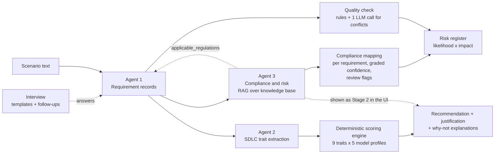
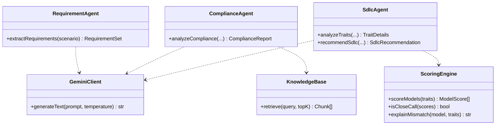

# Requora AI - Architecture and Design Notes

## Problem statement

Gathering software requirements and choosing the right SDLC model is manual and subjective, and it often ignores regulatory and risk constraints. Requora AI automates this: it generates structured requirements from a plain-language scenario, checks them against a compliance knowledge base using RAG, and recommends an SDLC model through deterministic, explainable scoring.

## Pipeline

In the UI the stages run as three separate calls: `/agents/requirements`, `/agents/compliance`, `/agents/sdlc`. The interview (`/agents/interview`, `/agents/interview/templates`) and quality check (`/agents/quality`) are API-only for now. `/agents/pipeline` runs requirements -> compliance (+ mapping) -> quality -> risk register -> SDLC in one request (6 LLM calls) and returns all of them, with `compliance_mapping` and `risk_register` as top-level keys; it accepts the same optional interview `answers` as `/agents/requirements`.

Note: the compliance result is displayed to the user but is not currently fed into the SDLC trait extraction. Both agents work from the same requirement list. Feeding compliance findings into criticality/verification scoring is a possible future improvement.

## Responsibilities

| Component | File | Responsibility |
|---|---|---|
| Requirement agent | `app/agents/requirement_agent.py` | Scenario + interview answers to requirement records (problem statement section 8 fields) |
| Interview agent | `app/agents/interview_agent.py`, `interview_templates.py` | Role-specific question templates (plain data) and the next follow-up questions (one LLM call) |
| Quality check | `app/agents/quality_agent.py` | Ambiguity, untestable Performance/Availability NFRs and near-duplicates by rules; conflicts by one LLM call |
| Compliance mapping | `app/agents/compliance_mapping.py` | Per-requirement section-11 mapping; code sets metadata, confidence and review flags |
| Risk register | `app/agents/risk_agent.py` | Risks with rubric-anchored likelihood and impact (one LLM call); score, level and rank in code |
| KB metadata | `knowledge_base/sources.json`, `app/rag/kb_metadata.py` | Source, jurisdiction, version, effective date and applicability per KB document; rule-based domain classification |
| Vocabulary | `app/vocabulary.py` | Stakeholder roles, interview topics, requirement categories and approval statuses, word for word from the problem statement |
| Compliance agent | `app/agents/compliance_agent.py` | One retrieval query per requirement, keep chunks under the threshold, compute `kb_relevance`, ground findings only in kept chunks, drop unsupported citations, report risk level |
| Output schemas | `app/schemas.py` (+ interview/quality modules) | Pydantic schemas for every LLM reply; validate, retry once, else 502 |
| SDLC agent | `app/agents/sdlc_agent.py` | Rubric-anchored trait extraction (with evidence), call scoring engine, write justification |
| Scoring engine | `app/agents/sdlc_rules.py` | Deterministic scoring of 5 SDLC models, close-call detection, why-not explanations |
| RAG | `app/rag/` | Gemini embeddings, ChromaDB ingestion and retrieval |
| Gemini client | `app/gemini_client.py` | Single place for model calls: backoff on 429, retry on 503, fallback across models on 404/empty; records which model answered (reported as `meta.model`) |
| API + UI | `app/main.py`, `app/static/` | FastAPI routes; single-page dashboard |

## Class diagram (logical)

## SDLC scoring methodology

1. The LLM rates the project on 9 traits (1-5) at temperature 0. The reply must contain all nine traits as integers 1-5 with evidence and a reason (`TraitRatings` in `app/schemas.py`); otherwise it is retried once and then rejected. A trait is never defaulted, because a silent 3 would push the result toward Incremental. It is given explicit rubric anchors for every trait and must cite evidence from the requirements (and from the original scenario text, which `/agents/sdlc` accepts as an optional `scenario` field) for each score. It does not choose the SDLC model.
2. Each model has a documented "ideal profile" over the same 9 traits. A model's compatibility score is `100 * (1 - weighted_distance / max_weighted_distance)`, where `weighted_distance = sum(weight[t] * |project[t] - profile[t]|)`. Every model is scored by the same formula with no per-model bonus (a test checks that each model scores exactly 100 on its own profile). That is not the same as equal win share: over all 5^9 possible trait vectors Incremental ranks first 39.7% of the time and Waterfall 8.5%, because Incremental's profile sits nearest the middle of the scale. See [Scoring analysis](#scoring-analysis).
3. The top model is recommended. Models are ranked on unrounded scores, never on the order the profiles are listed in. Two scores within 0.05 are a tie, broken by the smaller worst single-trait gap, then the smaller total unweighted gap, then alphabetical order; a tie is always a close call and the UI says so. If the runner-up is within 5.0 points the UI reports a close comparison instead of a decisive winner.
4. The LLM writes the justification from the measured scores and evidence, and is instructed never to contradict a score.
5. "Why not X?" text is generated by rules from the same distances, with no LLM call.

Why 9 traits: with only clarity, volatility, complexity and criticality, Spiral and V-Model had near-identical profiles and Spiral won most high-stakes scenarios. `risk_uncertainty` (novelty, not stakes) separates Spiral from V-Model; `verification_validation` separates V-Model from Waterfall; `stakeholder_feedback` separates Agile from Incremental; `incremental_suitability` and `prototyping_need` separate the iterative models from the rest.

### Profiles and weights (generated from `sdlc_rules.py`)

| Trait | Weight | Waterfall | V-Model | Incremental | Agile | Spiral |
|---|---|---|---|---|---|---|
| requirement clarity | 1.0 | 5 | 5 | 3 | 2 | 3 |
| requirement volatility | 1.2 | 1 | 1 | 3 | 5 | 3 |
| project complexity | 0.8 | 2 | 3 | 3 | 3 | 5 |
| project criticality | 1.0 | 2 | 5 | 2 | 2 | 5 |
| risk/uncertainty | 1.3 | 1 | 2 | 2 | 2 | 5 |
| verification & validation intensity | 1.1 | 2 | 5 | 2 | 1 | 3 |
| stakeholder feedback need | 1.2 | 1 | 1 | 3 | 5 | 2 |
| incremental delivery suitability | 1.0 | 1 | 1 | 5 | 5 | 2 |
| prototyping/experimentation need | 1.1 | 1 | 1 | 2 | 2 | 5 |

## Compliance retrieval

1. One query per requirement (the requirement text), embedded in one batch; top 3 chunks each.
2. Chunks are merged, keeping each chunk's closest distance and the requirements that matched it under the threshold.
3. The scenario is classified into domain tags by keyword rules over the domain label, the scenario and the requirement statements (`classify_domains`; problem statement section 6, step 1). Tags are the eight financial services from section 1 plus "Healthcare" and "Card or online payments" (an activity: card-payment security applies to a food-delivery app, KYC/AML does not). A source applies if its `applies_to` in `knowledge_base/sources.json` is `any` or shares a tag.
4. Only chunks with squared-L2 distance below **0.62** whose source applies to the domain go into the prompt (at most 8). Chunks from sources for other domains are reported with `applies_to_domain: false`, never cited and never counted.
5. `kb_relevance` is computed, not generated, and only **domain-specific** sources that **apply to the domain** count: no requirement matched a domain-specific chunk = `not_relevant`; at least half did = `relevant`; otherwise `partially_relevant`. Sources listed in `GENERIC_SOURCES` (currently `general_security_baseline`, whose own title says it is domain-agnostic) apply to almost any system, so matching them says nothing about domain coverage. The rule is defined per source and applies to every domain; there are no per-domain cases. Relevance is computed from every chunk under the threshold, before the 8-chunk prompt cap.
6. The LLM's considerations are schema-checked (known requirement IDs, real KB source names; invented names trigger the retry). Considerations citing a real source that was not among the kept chunks are dropped and listed in `dropped_considerations`; generic-baseline citations are kept even when `kb_relevance` is `not_relevant`, and every consideration carries `scope`: `"generic baseline"` or `"domain-specific"`.

The response keeps its original keys and adds `domain_tags`, `retrieved_chunks` (id, source, scope, distance, matched requirement IDs, `applies_to_domain`), `dropped_considerations`, `compliance_mapping`, and on each consideration `scope` plus the section-11 analysis fields. The current UI shows the source name but not the `scope` label.

Re-running the tuning set after this rule (2026-11-25) gave an identical sweep: threshold 0.62, precision 0.94, recall 0.81, as expected, since the rule changes how matches are aggregated, not which chunks pass. On domain-specific pairs alone, precision is 0.93 and recall 0.85 at 0.62. No tuning-set scenario changes label (none is baseline-only). Re-scoring the saved live railway runs, 1 and 3 change from `partially_relevant` to `not_relevant`, keeping their baseline citation.

Domain applicability rerun (2026-11-25): the threshold-stage sweep is unchanged (0.62, precision 0.94, recall 0.81). Counting only what the agent can now cite (under the threshold and applicable to the unit's domain), precision at 0.62 rises to 1.00 with recall unchanged at 0.81 (F0.5 0.909 to 0.955): both remaining false positives were cross-domain. On that basis the best threshold would be 0.66 (precision 0.97, recall 0.92, F0.5 0.960); 0.62 is kept until that trade-off is decided. Re-scoring the saved live runs: the social-media run whose logging requirement matched KYC/AML (0.60) now comes out `not_relevant`, and payroll keeps `partially_relevant` through `data_protection` with KYC/AML and payment security excluded.

Threshold tuning ([docs/RAG_TUNING.md](RAG_TUNING.md)): the old single concatenated query gave distances of 0.67-0.82 for all four evaluation scenarios, so nothing ever passed 0.65. With one query per requirement, labelled relevant pairs have a median distance of 0.52 and irrelevant pairs 0.80. The threshold was chosen by best F0.5 (precision weighted twice as much as recall, because a wrong citation is worse than a missing one) on a hand-labelled set of 42 queries: 0.62 gives precision 0.94 and recall 0.81, and none of the 27 "nothing applies" queries is cited. Caveats: one person labelled the set and it is small, and the railway event-logging requirement's nearest chunk (KYC/AML transaction logging, clearly irrelevant) sits at 0.626, only 0.006 above the threshold.

## Compliance mapping

`compliance_mapping` (in `/agents/compliance` and as a top-level key of `/agents/pipeline`) has one entry per requirement: `requirement_id`, `mappings`, `needs_human_review`, `review_reasons`, plus a `notice` that this is not a legal determination and a `review_count`. Each mapping follows problem statement section 11:

| Field | Set by | Meaning |
|---|---|---|
| `source`, `regulation`, `scope` | code | KB source, its title, generic baseline or domain-specific |
| `jurisdiction`, `version`, `effective_date` | code | from `knowledge_base/sources.json` (version and date of the KB entry, not of the law) |
| `chunk_id`, `distance` | code | the closest retrieved match for this requirement and source; `null` if the model cited the source without a match for this requirement |
| `status` | LLM | `satisfied`, `gap` or `not_applicable`; `not_assessed` (code) when a retrieved match was not assessed |
| `required_control` | LLM | the control the source expects (the consideration's `note`) |
| `evidence`, `evidence_verified` | LLM, checked by code | a quote from the retrieved source text; verified if at least 5 words appear in it (case and punctuation ignored) |
| `compliance_gap` | LLM | required when `status` is `gap`, otherwise null |
| `checkpoints`, `retention_and_reporting` | LLM | mandatory approval or audit checkpoints; data-retention and reporting obligations |
| `confidence` | code | High: distance < 0.50 and evidence verified; Medium: < 0.60 and verified; otherwise Low. The bands come from the tuning set: relevant pairs have a median of 0.52, and all 7 citable pairs between 0.55 and 0.62 are correct (the 2 wrong ones in that range are cross-domain and excluded by applicability); 0.60-0.62 stays Low as a margin |

`needs_human_review` is set, with a reason for each, when a mapping is Low confidence, was not assessed, was judged not applicable (retrieval and analysis disagree), was cited without a retrieval match, or is a gap on a requirement whose `risk_level` is High (section 11: high-impact interpretations need compliance or legal approval), and when a requirement categorised Regulatory has no domain-specific support (section 6: escalate unsupported output). It is a flag; nothing routes or approves it yet.

## Risk register

`risk_register` (pipeline only) lists 3-10 risks from one LLM call. The model writes the description, category (Business, Technical, Compliance, Security), mitigation, linked requirement ids, and likelihood and impact on anchored 1-5 rubrics (`LIKELIHOOD_RUBRIC`, `IMPACT_RUBRIC` in `app/agents/risk_agent.py`), each with a reason. Code computes `score` = likelihood x impact, `level` (High >= 10, Medium 5-9, Low 1-4), the ranking (score, then impact, then likelihood) and the `RISK-n` ids, and adds a summary with the level, likelihood and impact distributions. The prompt includes compliance gaps (mappings with status `gap`) and quality flags. Review flags are left out: most say a knowledge-base match is uncertain, not that a control is missing, and in the first live loan run they pushed every likelihood to 4-5. The statement names a "threat and risk register" and "business, technical and compliance risks" but no register fields; the fields follow the project plan.

Requirement `risk_level` (Agent 1) now has anchors too. In the Phase 1 loan run 6 of 8 requirements were High because the prompt defined risk only as "the risk if it is wrong or missing" with no scale, which almost anything in a regulated domain meets. The anchors now judge the consequence of that requirement failing (High: regulatory breach, financial loss, safety incident or sensitive-data exposure; Medium: recoverable harm; Low: inconvenience), and say a regulated domain is not by itself a reason for High.

## Scoring analysis

[docs/SCORING_ANALYSIS.md](SCORING_ANALYSIS.md) is generated by `python -m scripts.sensitivity --write` (offline).

- **Win share.** Over all 1,953,125 trait vectors: Incremental 39.7%, Spiral 28.2%, Agile 13.5%, V-Model 10.0%, Waterfall 8.5%. Central profiles are closer to everything. This describes the profile geometry, not how often each model should be recommended, and the profiles were not tuned to equalise it.
- **Sensitivity.** For the four live evaluation trait vectors, no single weight change (+/-0.2, x0.5, x1.5) or profile-cell change (+/-1) changes the winner (104 variants each). The only single-rating changes that flip a result are payroll's criticality or V&V one point lower (V-Model to Waterfall; payroll's margin is 4.1, a close call).

## Requirement records

Each requirement carries the fields problem statement section 8 lists, with section 9's categories and section 12's link back to the stakeholder statement:

| Field | Set by | Allowed values / rule |
|---|---|---|
| `id`, `requirement`, `priority` | LLM | unchanged keys; `FR-n` / `NFR-n`; High, Medium, Low |
| `type` | code | `FR` or `NFR`, from the list the record is in |
| `categories` | LLM | one or more of the 13 section-9 labels (multi-label) |
| `source_stakeholder` | LLM, or code | one of the 9 section-2 roles; if the quote comes from an interview answer, code sets it to that answer's role |
| `source_text` | LLM, checked by code | an exact quote (case and punctuation ignored, at least 2 words) from the scenario or an answer, or `""` when the requirement is inferred, in which case it must list `assumptions` |
| `business_justification` | LLM | non-empty |
| `dependencies` | LLM | other requirement ids in the same output |
| `assumptions` | LLM | per requirement (the old top-level list stays) |
| `acceptance_criteria` | LLM | at least one non-blank item |
| `applicable_regulations` | code | `[]` from Agent 1; `/agents/pipeline` fills in the domain-specific KB sources the compliance agent cited for that id (never the generic baseline) |
| `risk_level` | LLM | High, Medium, Low |
| `confidence` | code | High = quoted, no assumptions; Medium = quoted with assumptions; Low = no quote. A grade from evidence, not a model-reported score |
| `approval_status` | code | always `proposed` (allowed: proposed, accepted, rejected, modified); nothing changes it yet |

Whatever the LLM sends for the code-set fields is overwritten, so it cannot approve its own output, cite regulations or grade its own confidence. An invented quote fails validation and triggers the retry.

## Interview

`GET /agents/interview/templates` returns 27 hand-written questions, 3 per stakeholder role, covering all 13 section-7 topics. `POST /agents/interview` takes the scenario and the answers so far (`role`, `question`, `answer`, optional `question_id` / `topic`) and returns up to `max_questions` (default 5, max 10) next questions. Each is either a follow-up on a specific answer (`follows_up_on` = its index, with the reason it is vague, incomplete or inconsistent) or an unasked template question (`template_id`; code copies the template's wording, role and topic). Covered and uncovered topics are computed from the answers, not by the LLM. The caller keeps the answer list and sends it back each round.

## Quality checks

`POST /agents/quality` (and the `quality` key of `/agents/pipeline`) returns `flags` and `counts`. Each flag has `requirement_ids`, `type`, `reason`, `suggested_fix` and `detected_by`:

- **ambiguity** (rule): vague terms from `VAGUE_TERMS` (e.g. fast, user-friendly, secure, etc.) in the statement, matched on word boundaries; the fix points to a measurable acceptance criterion when one exists.
- **untestable** (rule): a non-functional requirement categorised Performance or Availability and reliability with no number anywhere in its statement or acceptance criteria. Other NFRs (an immutable audit trail, encryption) are testable without a number; checking them all produced a false positive in the Phase 1 live run.
- **duplicate** (rule): `difflib` similarity of at least 0.92 after removing "the system shall". 0.90 wrongly paired "encrypt payment data" with "encrypt user data".
- **conflict** (one LLM call, schema-checked): requirements that cannot all be met as written; at least two known ids; an empty list is a valid answer. Skipped when there are fewer than two requirements.

## Known limitations

- The compliance knowledge base is a small, curated set of paraphrased regulatory principles (31 chunks, 6 documents), not verbatim legal text. Cite it as a "curated compliance knowledge base".
- Trait scores come from an LLM, so they can vary between runs. The scoring that follows is deterministic.
- The relevance threshold (0.62) was tuned on a small single-labeller set (see above); the `kb_relevance` coverage rules (any match / half of the requirements) are a design choice.
- The risk level is still the LLM's judgement, not derived from the knowledge base.
- Requirement `priority`, `risk_level` and `categories` are LLM judgements checked only for allowed values; their accuracy is not measured.
- The quality rules are heuristics: the vague-term list is curated by hand, "untestable" only means "a Performance/Availability NFR with no number", and the duplicate check compares wording, not meaning. Quality flags are reported but not yet sent back to the interview step.
- `approval_status` is always `proposed`: there is no human accept/reject/modify step yet.
- Similarity alone cannot tell which domain a principle belongs to; two rules now compensate. Generic-baseline matches never count toward `kb_relevance`, and sources only apply to the domains listed in `knowledge_base/sources.json` (so payroll's and social media's matches to the KYC/AML logging paragraph no longer count or get cited). The domain classifier is keyword-based: a scenario that never uses the expected words (e.g. a lending system described only as "advances to customers") gets no tags, and its domain-specific sources are excluded. The tags are in the response so a reviewer can see this.
- In the Phase 2 live loan run, 4 of 8 requirements were flagged for review, all because their best match fell in the then-Low band 0.55-0.62, although the matches were correct (e.g. fair_lending for decline reasons at 0.58). The tuning data showed every citable pair in that range was correct, so Medium was widened to 0.60; re-grading that run's saved mapping gives 1 of 8 (only the 0.62 audit-log match). The evidence is 7 labelled pairs from one labeller.
- Compliance `status`, the required control and the risk register's likelihood and impact are LLM judgements, checked only for allowed values and (for evidence) quotes; their accuracy is not measured. The confidence bands come from a small single-labeller tuning set.
- No confidence percentages are shown, because none are computed.
