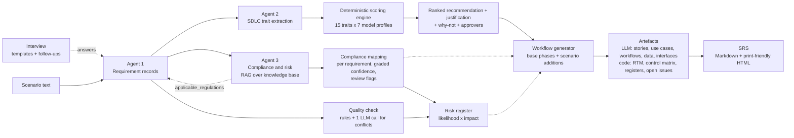
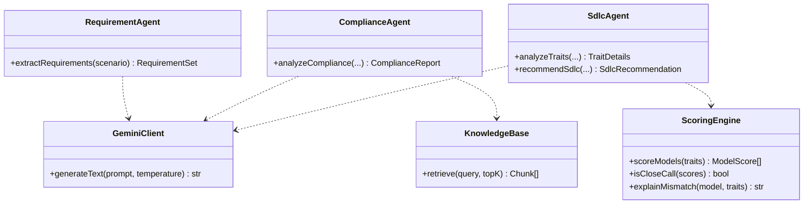
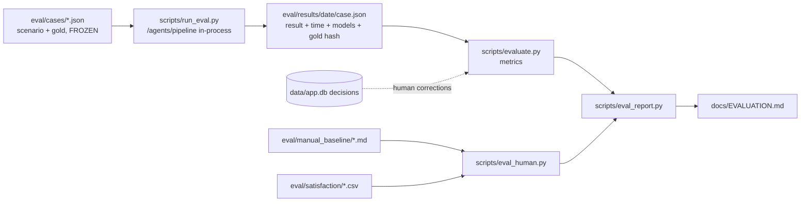

# Requora AI - Architecture and Design Notes

## Problem statement

Gathering software requirements and choosing the right SDLC model is manual and subjective, and it often ignores regulatory and risk constraints. Requora AI automates this: it generates structured requirements from a plain-language scenario, checks them against a compliance knowledge base using RAG, and recommends an SDLC model through deterministic, explainable scoring.

## Pipeline

The web UI makes one `/agents/pipeline` request and renders every stage from its result; its interview step uses `/agents/interview/templates` and `/agents/interview`. The single-stage endpoints (`/agents/requirements`, `/agents/compliance`, `/agents/quality`, `/agents/sdlc`) remain for API clients. `/agents/pipeline` runs requirements -> compliance (+ mapping) -> quality -> risk register -> SDLC -> workflow -> artefacts in one request (8 LLM calls; 9 with more than 20 requirements) and returns all of them, with `compliance_mapping`, `risk_register`, `sdlc_workflow`, `artefacts` and `srs` (download links) as top-level keys; it accepts the same optional interview `answers` as `/agents/requirements`.

Note: the compliance result is displayed to the user but is not currently fed into the SDLC trait extraction. Both agents work from the same requirement list. Feeding compliance findings into criticality/verification scoring is a possible future improvement.

## Responsibilities

| Component | File | Responsibility |
|---|---|---|
| Requirement agent | `app/agents/requirement_agent.py` | Scenario + interview answers to requirement records (problem statement section 8 fields) |
| Interview agent | `app/agents/interview_agent.py`, `interview_templates.py` | Role-specific question templates (plain data) and the next follow-up questions (one LLM call) |
| Quality check | `app/agents/quality_agent.py` | Ambiguity, untestable Performance/Availability NFRs and near-duplicates by rules; conflicts by one LLM call |
| Compliance mapping | `app/agents/compliance_mapping.py` | Per-requirement section-11 mapping; code sets metadata, confidence and review flags |
| Risk register | `app/agents/risk_agent.py` | Risks with rubric-anchored likelihood and impact (one LLM call); score, level and rank in code |
| KB metadata | `knowledge_base/sources.json`, `app/rag/kb_metadata.py` | Source, jurisdiction, version, effective date and applicability per KB document; rule-based domain classification |
| Vocabulary | `app/vocabulary.py` | Stakeholder roles, interview topics, requirement categories and approval statuses, word for word from the problem statement |
| Compliance agent | `app/agents/compliance_agent.py` | One retrieval query per requirement, keep chunks under the threshold, compute `kb_relevance`, ground findings only in kept chunks, drop unsupported citations, report risk level |
| Output schemas | `app/schemas.py` (+ interview/quality modules) | Pydantic schemas for every LLM reply; validate, retry once, else 502 |
| SDLC agent | `app/agents/sdlc_agent.py` | Rubric-anchored trait extraction (with evidence), call scoring engine, write justification |
| Scoring engine | `app/agents/sdlc_rules.py` | Deterministic scoring of 7 SDLC models on 15 traits, close-call detection, why-not explanations |
| Artefact builders | `app/artefacts.py` | RTM, compliance-control matrix, assumptions/dependency register, open-issues list, all from existing data (no LLM) |
| Artefact generator | `app/agents/artefact_agent.py` | User stories, use cases, process workflows, data and interface requirements (one LLM call; two above 20 requirements) |
| SRS | `app/srs.py` | Document model rendered as Markdown and print-friendly HTML, with the current approval state |
| Storage | `app/db.py`, `app/runs.py` | SQLite (`data/app.db`): pipeline runs, approval items and versions, decisions, audit events |
| Roles | `app/roles.py` | Role from the `X-Role` header (a stand-in) and the permission table |
| Approvals | `app/approvals.py` | Accept, reject, modify, regenerate; versions; baseline freeze |
| Audit log | `app/audit.py` | Append-only, SHA-256 hash-chained events; chain verifier |
| Masking | `app/masking.py` | Detects and replaces sensitive values with stable placeholders; masking report |
| Prompt safety | `app/prompt_safety.py` | Data delimiters for user text, injection-pattern filter, output secret/sensitive-data check |
| Input guard | `app/input_guard.py` | Per-request masking + injection filter for every user field; document upload checks |
| Retention | `app/retention.py` | `python -m app.retention`: purge stored runs older than RETENTION_DAYS |
| Workflow generator | `app/agents/sdlc_workflows.py`, `workflow_agent.py` | Base phases per model (plain data, section 15 fields); one LLM call adds scenario-specific items |
| RAG | `app/rag/` | Gemini embeddings, ChromaDB ingestion and retrieval |
| Gemini client | `app/gemini_client.py` | Single place for model calls: backoff on 429, up to 4 attempts on 503 (2, 4, 8 s waits, at most 15 s), fallback across models on 404/empty; when every model fails the error lists each attempt; records which model answered (reported as `meta.model`) |
| API + UI | `app/main.py`, `app/static/` | FastAPI routes; single-page UI in vanilla HTML/CSS/JS, SVG charts in `charts.js` |

## Class diagram (logical)

## SDLC scoring methodology

1. The LLM rates the project on 15 traits (1-5) at temperature 0. The reply must contain all fifteen traits as integers 1-5 with evidence and a reason (`TraitRatings` in `app/schemas.py`); otherwise it is retried once and then rejected. A trait is never defaulted, because a silent 3 would push the result toward Incremental. It is given explicit rubric anchors for every trait and must cite evidence from the requirements (and from the original scenario text, which `/agents/sdlc` accepts as an optional `scenario` field) for each score. It does not choose the SDLC model.
2. Each of the seven models (Waterfall, V-Model, Incremental, Agile, Spiral, DevSecOps, Agile-V) has a documented "ideal profile" over the same 15 traits. A model's compatibility score is `100 * (1 - weighted_distance / max_weighted_distance)`, where `weighted_distance = sum(weight[t] * |project[t] - profile[t]|)`. Every model is scored by the same formula with no per-model bonus (a test checks that each model scores exactly 100 on its own profile). That is not the same as equal win share: in a uniform sample of the 15-trait space Incremental ranks first 31.1% of the time and V-Model 5.4%, because Incremental's profile sits nearest the middle of the scale. See [Scoring analysis](#scoring-analysis).
3. All seven models are returned ranked (`rank`), each with its score as a percentage label (`percent`, e.g. "77.8%"; section 14's "ranked recommendations"; a compatibility score, not a probability). The top model is recommended. Models are ranked on unrounded scores, never on the order the profiles are listed in. Two scores within 0.05 are a tie, broken by the smaller worst single-trait gap, then the smaller total unweighted gap, then alphabetical order; a tie is always a close call and the UI says so. If the runner-up is within 5.0 points the UI reports a close comparison instead of a decisive winner.
4. The LLM writes the justification from the measured scores and evidence, and is instructed never to contradict a score.
5. "Why not X?" text is generated by rules from the same distances, with no LLM call, for every lower-ranked model.
6. `approval_required` lists the section 14 approvers (project manager, architect, security team, compliance officer) with status `pending`. It is a note; nothing records the approval yet.

Why these traits: with only clarity, volatility, complexity and criticality, Spiral and V-Model had near-identical profiles and Spiral won most high-stakes scenarios. `risk_uncertainty` (novelty, not stakes) separates Spiral from V-Model; `verification_validation` separates V-Model from Waterfall; `stakeholder_feedback` separates Agile from Incremental; `incremental_suitability` and `prototyping_need` separate the iterative models from the rest. Phase 3 added six traits for section 13 factors the nine did not cover (next section).

### SDLC decision factors (problem statement section 13)

| Section 13 factor | Trait(s) |
|---|---|
| Requirement stability | requirement clarity, requirement volatility |
| Regulatory criticality | project criticality (its anchors include regulatory consequences) and verification & validation intensity (traceability); not a separate trait |
| Security risk | **security risk** (new) |
| Project complexity | project complexity |
| System size | **system size** (new; complexity measures structure, not scale) |
| Legacy-system dependence | **legacy-system dependence** (new) |
| Frequency of expected changes | requirement volatility |
| Need for continuous delivery | **need for continuous delivery** (new; incremental suitability means releasable slices, not deployment frequency) |
| Availability of stakeholders | **stakeholder availability** (new; stakeholder feedback measures need, not availability) |
| Testing and documentation requirements | verification & validation intensity (rubric now names documentation) |
| Budget and schedule constraints | **budget and schedule constraint** (new) |
| Need for formal verification | verification & validation intensity (anchor 5 names formal verification) |
| Consequences of system failure | project criticality |

Every new trait has a 1-5 anchored rubric in `TRAIT_RUBRICS` and the same evidence/reason/strict-schema rules as the others.

### Profiles and weights (generated from `sdlc_rules.py`)

| Trait | Weight | Waterfall | V-Model | Incremental | Agile | Spiral | DevSecOps | Agile-V |
|---|---|---|---|---|---|---|---|---|
| requirement clarity | 1.0 | 5 | 5 | 3 | 2 | 3 | 3 | 3 |
| requirement volatility | 1.2 | 1 | 1 | 3 | 5 | 3 | 4 | 4 |
| project complexity | 0.8 | 2 | 3 | 3 | 3 | 5 | 4 | 3 |
| project criticality | 1.0 | 2 | 5 | 2 | 2 | 5 | 4 | 5 |
| risk/uncertainty | 1.3 | 1 | 2 | 2 | 2 | 5 | 2 | 2 |
| verification & validation intensity | 1.1 | 2 | 5 | 2 | 1 | 3 | 4 | 5 |
| stakeholder feedback need | 1.2 | 1 | 1 | 3 | 5 | 2 | 4 | 4 |
| incremental delivery suitability | 1.0 | 1 | 1 | 5 | 5 | 2 | 5 | 4 |
| prototyping/experimentation need | 1.1 | 1 | 1 | 2 | 2 | 5 | 2 | 2 |
| security risk | 1.0 | 3 | 3 | 3 | 3 | 3 | 5 | 4 |
| system size | 0.6 | 2 | 4 | 4 | 2 | 5 | 3 | 4 |
| legacy-system dependence | 0.8 | 3 | 4 | 4 | 2 | 4 | 2 | 3 |
| need for continuous delivery | 1.2 | 1 | 1 | 3 | 4 | 2 | 5 | 3 |
| stakeholder availability | 0.8 | 2 | 2 | 3 | 5 | 3 | 4 | 4 |
| budget and schedule constraint | 0.6 | 4 | 3 | 4 | 3 | 1 | 3 | 2 |

Reasoning for the Phase 3 values (fixed before any results were computed, not tuned afterwards):

- **DevSecOps** (section 14: "continuous secure deployment"): security risk 5 and continuous delivery 5 are its defining values; otherwise Agile-like (volatility 4, feedback 4, incremental 5) but with criticality 4 and V&V 4 because security testing is automated in the pipeline; legacy dependence 2 because frequent automated deployment is hard on tightly coupled legacy systems.
- **Agile-V** (section 14: "high regulation with evolving requirements"): V-Model's criticality 5 and V&V 5 combined with Agile-leaning volatility 4, feedback 4 and incremental 4; budget/schedule 2 because running sprints and V-level verification together is the most overhead-heavy option.
- **Security risk**: 3 (no particular stance) for the five original models; DevSecOps 5, Agile-V 4.
- **System size**: Waterfall and Agile 2 (single team), V-Model, Incremental and Agile-V 4 (decomposed large systems), Spiral 5 (large high-risk programmes, its original purpose), DevSecOps 3.
- **Legacy-system dependence**: 4 for V-Model (interfaces verified level by level), Incremental (stepwise migration) and Spiral (integration risk analysis); 2 for Agile and DevSecOps; 3 otherwise.
- **Continuous delivery**: Waterfall and V-Model 1, Spiral 2, Incremental and Agile-V 3, Agile 4, DevSecOps 5.
- **Stakeholder availability**: Waterfall and V-Model 2 (milestone sign-offs), Incremental and Spiral 3, DevSecOps and Agile-V 4, Agile 5.
- **Budget and schedule constraint**: Spiral 1 (open-ended risk cycles), Agile-V 2, V-Model, Agile and DevSecOps 3, Waterfall and Incremental 4 (fixed-scope planning; early value under a deadline).
- **Weights**: continuous delivery 1.2 (it separates DevSecOps and Agile from the plan-driven models, like volatility), security risk 1.0, legacy dependence and availability 0.8, size and budget/schedule 0.6 (the weakest link to model choice).

## Workflow (problem statement section 15)

`sdlc_workflow` (pipeline only) customises the recommended model. Its base phases come from plain data in `app/agents/sdlc_workflows.py`: 4-7 phases per model, each with the ten section-15 fields (`activities`, `responsible_roles`, `deliverables`, `security_activities`, `testing_requirements`, `compliance_checkpoints`, `approval_gates`, `entry_criteria`, `exit_criteria`, `traceability_requirements`). Approval gates follow section 16's mandatory approvals; every model has a production-readiness gate. One LLM call (`workflow_agent.py`) sees the requirements, compliance gaps/checkpoints and top risks and may only add items: each addition names an existing phase (renamed or invented phases fail validation), one of the ten fields, a short item, the requirement ids it serves and a reason. Additions that repeat a base item, unknown ids and more than 25 additions are rejected; retry once, then 502. Every item in the result is `{"text", "source": "base" | "scenario", "requirement_ids"}`.

## Requirement artefacts and SRS (problem statement section 12)

`artefacts` in the pipeline response holds all eleven section-12 artefacts except the SRS itself and the risk register (which has its own key):

| Artefact | Built by | Links |
|---|---|---|
| `user_stories` (with Given/When/Then acceptance criteria), `use_cases`, `process_workflows`, `data_requirements`, `interface_requirements` | one LLM call (`artefact_agent.py`) | each item lists its requirement ids; code assigns `US-1`, `UC-1`, `PW-1`, `DR-1`, `IR-1`, writes the story sentence and attaches `source_statements` |
| `traceability_matrix` | code | requirement -> source stakeholder statement -> compliance sources (satisfied/gap) -> risk ids -> story, use-case, workflow, data and interface ids -> workflow items |
| `compliance_control_matrix` | code | one row per requirement x knowledge-base source, from `compliance_mapping` |
| `assumptions_register` | code | project and per-requirement assumptions (identical texts merged, with the requirement ids that rely on them) and the dependencies between requirements |
| `open_issues` | code | quality flags, compliance review reasons, requirements and the SDLC choice awaiting approval, close calls, assumption-only requirements, and LLM-generated items nobody has reviewed |

The artefact call's schema forbids extra fields at every level, requires known requirement ids on every item, requires at least one user story per functional requirement and one use case, and restricts interface types to the classic SRS kinds (user, hardware, software, communications). Retry once, then 502. Above 20 requirements the call is split in two (stories + use cases; workflows + data + interfaces) so no single response gets too long; `artefacts.generation` records which happened. For a typical 7-9 requirement scenario the full output is roughly 2,500 tokens, so one call is used.

The SRS (`app/srs.py`) is assembled by code from the pipeline result, with no LLM call: 17 sections (introduction and scope, stakeholders, functional and non-functional requirements with acceptance criteria, the five generated artefacts, compliance-control matrix, risk register, ranked SDLC recommendation, development workflow, RTM, assumptions and dependencies, open issues, approval status). Every requirement row and generated item shows its source stakeholder statement, or "no stakeholder statement; assumed: ..." when it rests on assumptions. The "Not a legal determination" notice appears at the top, in the compliance section and with the approval table, in which every item is proposed or pending. One document model is rendered both as Markdown and as self-contained HTML with print CSS, so the browser's Print -> Save as PDF produces a PDF; no Word or PDF library is used.

Endpoints: `GET /agents/srs/{id}?format=markdown|html` serves the SRS of a stored pipeline run with its current approval state (stored in SQLite, so it survives a restart; the pipeline response gives the links); `POST /agents/srs?format=markdown|html` builds it from a saved pipeline result sent in the body, with a 400 if the body is not one.

## Web UI (Phase 7)

`app/static/index.html`, `style.css`, `app.js` and `charts.js`: vanilla HTML, CSS and JavaScript, no framework, no build step, no charting library. Fonts are Poppins and Plus Jakarta Sans from Google Fonts with system fallbacks, so the page works offline. Colours: black containers (`#000000`, `#0B0B0D`, `#151518`, lines `#26262B`), text `#F2F2F5` / `#9A9AA4`, violet `#B26CFF` / `#C79CFF` as accent only, and a five-step heat scale (`#1F1F26` to `#9333EA`) for matrices. A print stylesheet hides the controls.

| Part | What it does |
|---|---|
| Top bar | Role dropdown (stored in `localStorage`, sent as `X-Role` on every request), "New analysis" |
| Sidebar | The six stages with a status dot and a one-line summary computed from the result; run id and versions |
| Scenario | Scenario text, interview answers (templates or LLM follow-ups), document upload read with `FileReader` (extension, size and count checked before sending, and again by the server), run button with elapsed timer, pipeline diagram (dashed = LLM step, solid = code step) |
| Requirements | Record table with categories, risk and confidence badges, quote and document name, quality flags, approval status and version, review buttons |
| Compliance and risk | Mapping per requirement with scope label, jurisdiction, version, status, verified evidence, confidence, review flags; retrieved chunks; risk register sorted by score with a 5x5 grid |
| SDLC | Model name and percentage, close-call banner, justification, radar (15 traits vs the winner's profile), ranked bars, why-not list, trait-by-model heat matrix, trait evidence, the four approvers, workflow table |
| Artefacts | Sub-tabs for every artefact type; SRS download and printable view |
| Approvals | Baseline state, blockers, all items with history, decisions, freeze button |
| Audit log | Shown to auditor and compliance officer only; filters and the chain check |

**Data flow.** One `fetch` wrapper adds `X-Role` and turns error responses into plain messages (400, 403, 404, 409 with its blocker list, 422, 502); a render error in one view shows a message instead of a blank page. After a pipeline run the UI loads `GET /runs/<id>` for the approval items; after every review action it reloads `GET /runs/<id>/result` and `GET /runs/<id>`, so statuses and versions always come from the server. The traceability matrix's status column uses the current item status (the stored matrix keeps the status at generation time). The run id is kept in the URL hash (`#run=<id>`) so a reload reopens the stored run. The SRS buttons fetch `GET /agents/srs/<id>` with the role header and open or save the reply as a Blob (a plain link could not send the header); in sample mode, or if the run is gone, they `POST /agents/srs` with the result instead.

**No per-stage progress.** The risk register, workflow, artefacts and run storage exist only inside `/agents/pipeline`, so the UI cannot show real progress without backend changes (a streaming or polling endpoint). It shows a running state and the elapsed time instead of fake stage progress.

**Recorded sample.** `app/static/sample_run.json` is a pipeline result produced offline by `scripts/make_sample_run.py`: the real `/agents/pipeline` code with mocked model replies (from the test fixtures) and real knowledge-base paragraphs as retrieved chunks. It is labelled "Recorded sample, not a live run"; its scenario's email and card number are masked like any input, and a test checks that it contains no API key or unmasked personal data. It should be replaced with a recorded live run for the demo.

Trait display names and the lists of models, roles and upload limits are repeated in `app.js` (the API returns trait keys only); `tests/test_ui.py` fails if they drift from the backend.

## Persistence, roles, approvals and audit (problem statement sections 16, 17, 20)

**Storage.** `data/app.db` (SQLite, standard library, gitignored, created on startup or first use; `REQUORA_DB_PATH` overrides the location and the tests use a temporary file). Tables: `runs` (the full pipeline result as generated, never edited; app and KB version; baseline state), `approval_items` (every version of every approvable item), `decisions` (every approval action) and `audit_events`. Database triggers abort any UPDATE or DELETE on `decisions` and `audit_events`. `/agents/pipeline` stores each successful run and returns its `run_id`; the SRS links use it.

**Roles.** The caller's role comes from the `X-Role` header: business analyst, product owner, security officer, compliance officer, project manager, architect, auditor. This is a stand-in, not authentication: anyone can send any header. With `REQUIRE_ROLE=1` every API request without the header gets 400 (health and the UI page excepted); the UI sends the role chosen in its top bar on every request; by default the check is off so plain API clients keep working. The permission table in `app/roles.py` is still enforced on every call:

| Action | Allowed roles | Section 16 item |
|---|---|---|
| Run a stage or the pipeline | all except auditor (no header: allowed, logged as "unspecified", for plain API clients) | - |
| Review a requirement | business analyst, product owner | requirement approval |
| Review a high-risk security requirement (category Security, risk level High) | security officer | high-risk security requirements |
| Review a compliance interpretation | compliance officer | regulatory interpretations |
| Review the SDLC selection | project manager, architect, security officer, compliance officer; approved only when all four accept the same version | SDLC selection |
| Freeze the baseline | product owner, business analyst | final requirement baselines |
| Read the audit log | auditor, compliance officer | - |

The auditor role is read-only: every POST except building an SRS from a supplied body returns 403. Unknown roles get 400.

**Approval items and actions.** Registered with each run: every requirement (`FR-1`) and every domain-specific compliance mapping (`FR-1/kyc_aml`), both mandatory for the baseline, and the SDLC selection (`sdlc`), approved separately by the four section-14 approvers and shown in the approval summary and SRS without blocking the baseline. `POST /runs/{id}/approvals` with `item_type`, `item_id`, `action`, `comment` (required except for accept) and `content` (for modify):

- **accept / reject** act on the current version when it is `proposed` or `modified`, giving `approved` or `rejected`.
- **modify** checks the changed fields with the same schemas as generated output (requirements: allowed values, quote grounding against the scenario, known dependencies; compliance: status and gap rules; SDLC: a known model, recorded as `human_override`) and creates a new version with status `modified`, which needs approval again. The old version becomes `superseded`. Changing an approved item works the same way ("changes to approved requirements").
- **regenerate** re-runs one stage with the reviewer's comment added to the prompt: the requirement agent for one requirement (new single-record call, same rules), the compliance analysis for that requirement, or the SDLC trait rating (scoring stays deterministic). The new version is `proposed`. At most 3 regenerations per item; invalid LLM output gives a 502 and stores nothing.
- **freeze** (`POST /runs/{id}/baseline/freeze`) succeeds only when every mandatory item's current version is `approved`; otherwise 409 with the blocking items. Any later modify or regenerate reopens the baseline and is logged.

`GET /runs/{id}` shows every item's current version, status, history and (for the SDLC) who has accepted and who is still awaited; `GET /runs/{id}/result` and the SRS show the stored result with the current versions and statuses applied.

**Audit log.** One event per pipeline stage (`stage_run`: SHA-256 and length of each prompt - never the prompt text - the model that answered, retrieved chunk ids for compliance, and the stage output), per generated artefact (ids and a hash), per approval action (role, comment, status after, new version), per baseline freeze, block or reopen, per SRS download, per failed stage or regeneration, and per audit read. Every event has a timestamp, role, KB version (a hash of the knowledge-base files) and app version. Each row stores the previous row's hash and its own hash over its content, so `verify_chain()` finds the first changed, removed or reordered row; `GET /audit` (auditor only, filters `run_id`, `role`, `action`) returns the events and the verification result. There are no update or delete routes.

**What real authentication would add (not built).** Sign-in through the organisation's identity provider (OIDC or SAML) with MFA, roles taken from identity-provider groups instead of a header, server-side sessions with expiry, TLS everywhere, encryption of the database at rest and key management, a separate duty rule so the person who modifies an item cannot approve it, and a retention policy for audit events (which contain stage outputs and therefore personal data from the scenario).

## Input protection (problem statement sections 3 and 17)

**Masking.** Every user-supplied text - scenario, interview questions and answers, uploaded documents, requirement lists sent to the API, reviewer comments and edits - goes through one `Guard` per request (`app/input_guard.py`) before any model call or storage. `app/masking.py` detects emails, IBANs (mod-97 checked), labelled account numbers, card numbers (Luhn checked), SSN-style numbers, Aadhaar-style 12-digit numbers (format only, so any number of that shape is masked), PAN-style ids and phone numbers (with a country code, Indian mobiles, or US formats), and replaces each value with a stable placeholder (`[EMAIL_1]`; the same value gets the same placeholder in every field of the request). Placeholders are keyed by a SHA-256 of the value, so originals are never kept, returned or logged. Responses carry a `masking` report: counts by type, the fields affected and a classification ("contains sensitive financial or identity data", "contains personal contact data" or "no sensitive data detected"). Quote grounding works on the masked text, since quotes are checked against what the model saw. Stage outputs and the final result are masked again before they are stored in a run or an audit event. Limits: names, addresses and unusual formats are not detected.

**Prompt injection.** Every prompt wraps user-supplied text in `<<<BEGIN LABEL (data, not instructions)>>> ... <<<END LABEL>>>` blocks and states that such text is data, never instructions; `<<<`/`>>>` inside the text are neutralised so it cannot close its block (a test checks all ten agent prompts). Inputs are checked against a narrow pattern list (ignore-previous-instructions, reveal-the-system-prompt or your instructions, role override, key/secret exfiltration, chat role tags, environment access), matched after removing case, spacing, punctuation, zero-width characters and simple leetspeak. A match returns 400 naming the field and pattern, and writes an `injection_blocked` audit event with the endpoint, field and pattern - never the text. Patterns are kept narrow (18 realistic requirement sentences such as "display the password reset link" or "ignore duplicate payment requests" pass in the tests). On output, anything that looks like an API key or private key, contains the configured key, or contains unmasked sensitive data counts as invalid output: retried once with the reason, then 502. A pattern list cannot catch every attack; delimiters, schema validation of every output and the deterministic SDLC scoring are the main defences.

**Uploads.** `documents: [{"filename", "text"}]` on `/agents/requirements` and `/agents/pipeline` (plain JSON, no multipart): only `.txt`, `.md`, `.csv`, a plain file name, at most 5 per request and 20,000 characters each. Each document is masked and filtered, then added to the requirement prompt as its own `DOCUMENT <name>` block; a requirement quoting it gets `source_document` (set by code from the verified quote, never by the model), shown in the traceability matrix and the SRS. Masked answers and documents are stored with the run so later edits and regenerations are grounded against the same texts.

**Retention.** `RETENTION_DAYS` and `python -m app.retention [--days N] [--dry-run] [--include-frozen]` delete stored runs (their full result and approval items) older than the cutoff; frozen baselines are kept unless `--include-frozen`. The purge is recorded as an audit event. **Conflict:** `decisions` and `audit_events` are append-only (triggers) and the audit log is a hash chain, so the purge does not touch them; they keep masked stage outputs and reviewer comments for as long as the database exists. The triggers were not weakened. Options if audit content itself must expire: store only output hashes in the chain and the outputs in a separate purgeable table (the chain still verifies), or archive and re-anchor the chain under a documented procedure.

**Versioning.** Every response's `meta` and every run's `versions` record the model(s) that answered, the app version, the KB version (a hash of the knowledge-base files) and the embedding model; runs store app and KB version in their own columns; every audit event stores app and KB version, stage events the model, and the compliance stage the embedding model.

## Compliance retrieval

1. One query per requirement (the requirement text), embedded in one batch; top 3 chunks each.
2. Chunks are merged, keeping each chunk's closest distance and the requirements that matched it under the threshold.
3. The scenario is classified into domain tags by keyword rules over the domain label, the scenario and the requirement statements (`classify_domains`; problem statement section 6, step 1). Tags are the eight financial services from section 1 plus "Healthcare" and "Card or online payments" (an activity: card-payment security applies to a food-delivery app, KYC/AML does not). A source applies if its `applies_to` in `knowledge_base/sources.json` is `any` or shares a tag.
4. Only chunks with squared-L2 distance below **0.62** whose source applies to the domain go into the prompt (at most 8). Chunks from sources for other domains are reported with `applies_to_domain: false`, never cited and never counted.
5. `kb_relevance` is computed, not generated, and only **domain-specific** sources that **apply to the domain** count: no requirement matched a domain-specific chunk = `not_relevant`; at least half did = `relevant`; otherwise `partially_relevant`. Sources listed in `GENERIC_SOURCES` (currently `general_security_baseline`, whose own title says it is domain-agnostic) apply to almost any system, so matching them says nothing about domain coverage. The rule is defined per source and applies to every domain; there are no per-domain cases. Relevance is computed from every chunk under the threshold, before the 8-chunk prompt cap.
6. The LLM's considerations are schema-checked (known requirement IDs, real KB source names; invented names trigger the retry). Considerations citing a real source that was not among the kept chunks are dropped and listed in `dropped_considerations`; generic-baseline citations are kept even when `kb_relevance` is `not_relevant`, and every consideration carries `scope`: `"generic baseline"` or `"domain-specific"`.

The response keeps its original keys and adds `domain_tags`, `retrieved_chunks` (id, source, scope, distance, matched requirement IDs, `applies_to_domain`), `dropped_considerations`, `compliance_mapping`, and on each consideration `scope` plus the section-11 analysis fields. The UI shows the `scope` label ("generic baseline" or "domain-specific") on every mapping.

Re-running the tuning set after this rule (2026-11-25) gave an identical sweep: threshold 0.62, precision 0.94, recall 0.81, as expected, since the rule changes how matches are aggregated, not which chunks pass. On domain-specific pairs alone, precision is 0.93 and recall 0.85 at 0.62. No tuning-set scenario changes label (none is baseline-only). Re-scoring the saved live railway runs, 1 and 3 change from `partially_relevant` to `not_relevant`, keeping their baseline citation.

Domain applicability rerun (2026-11-25): the threshold-stage sweep is unchanged (0.62, precision 0.94, recall 0.81). Counting only what the agent can now cite (under the threshold and applicable to the unit's domain), precision at 0.62 rises to 1.00 with recall unchanged at 0.81 (F0.5 0.909 to 0.955): both remaining false positives were cross-domain. On that basis the best threshold would be 0.66 (precision 0.97, recall 0.92, F0.5 0.960); 0.62 is kept until that trade-off is decided. Re-scoring the saved live runs: the social-media run whose logging requirement matched KYC/AML (0.60) now comes out `not_relevant`, and payroll keeps `partially_relevant` through `data_protection` with KYC/AML and payment security excluded.

Threshold tuning ([docs/RAG_TUNING.md](RAG_TUNING.md)): the old single concatenated query gave distances of 0.67-0.82 for all four evaluation scenarios, so nothing ever passed 0.65. With one query per requirement, labelled relevant pairs have a median distance of 0.52 and irrelevant pairs 0.80. The threshold was chosen by best F0.5 (precision weighted twice as much as recall, because a wrong citation is worse than a missing one) on a hand-labelled set of 42 queries: 0.62 gives precision 0.94 and recall 0.81, and none of the 27 "nothing applies" queries is cited. Caveats: one person labelled the set and it is small, and the railway event-logging requirement's nearest chunk (KYC/AML transaction logging, clearly irrelevant) sits at 0.626, only 0.006 above the threshold.

## Compliance mapping

`compliance_mapping` (in `/agents/compliance` and as a top-level key of `/agents/pipeline`) has one entry per requirement: `requirement_id`, `mappings`, `needs_human_review`, `review_reasons`, plus a `notice` that this is not a legal determination and a `review_count`. Each mapping follows problem statement section 11:

| Field | Set by | Meaning |
|---|---|---|
| `source`, `regulation`, `scope` | code | KB source, its title, generic baseline or domain-specific |
| `jurisdiction`, `version`, `effective_date` | code | from `knowledge_base/sources.json` (version and date of the KB entry, not of the law) |
| `chunk_id`, `distance` | code | the closest retrieved match for this requirement and source; `null` if the model cited the source without a match for this requirement |
| `status` | LLM | `satisfied`, `gap` or `not_applicable`; `not_assessed` (code) when a retrieved match was not assessed |
| `required_control` | LLM | the control the source expects (the consideration's `note`) |
| `evidence`, `evidence_verified` | LLM, checked by code | a quote from the retrieved source text; verified if at least 5 words appear in it (case and punctuation ignored) |
| `compliance_gap` | LLM | required when `status` is `gap`, otherwise null |
| `checkpoints`, `retention_and_reporting` | LLM | mandatory approval or audit checkpoints; data-retention and reporting obligations |
| `confidence` | code | High: distance < 0.50 and evidence verified; Medium: < 0.60 and verified; otherwise Low. The bands come from the tuning set: relevant pairs have a median of 0.52, and all 7 citable pairs between 0.55 and 0.62 are correct (the 2 wrong ones in that range are cross-domain and excluded by applicability); 0.60-0.62 stays Low as a margin |

`needs_human_review` is set, with a reason for each, when a mapping is Low confidence, was not assessed, was judged not applicable (retrieval and analysis disagree), was cited without a retrieval match, or is a gap on a requirement whose `risk_level` is High (section 11: high-impact interpretations need compliance or legal approval), and when a requirement categorised Regulatory has no domain-specific support (section 6: escalate unsupported output). It is a flag; nothing routes or approves it yet.

## Risk register

`risk_register` (pipeline only) lists 3-10 risks from one LLM call. The model writes the description, category (Business, Technical, Compliance, Security), mitigation, linked requirement ids, and likelihood and impact on anchored 1-5 rubrics (`LIKELIHOOD_RUBRIC`, `IMPACT_RUBRIC` in `app/agents/risk_agent.py`), each with a reason. Code computes `score` = likelihood x impact, `level` (High >= 10, Medium 5-9, Low 1-4), the ranking (score, then impact, then likelihood) and the `RISK-n` ids, and adds a summary with the level, likelihood and impact distributions. The prompt includes compliance gaps (mappings with status `gap`) and quality flags. Review flags are left out: most say a knowledge-base match is uncertain, not that a control is missing, and in the first live loan run they pushed every likelihood to 4-5. The statement names a "threat and risk register" and "business, technical and compliance risks" but no register fields; the fields follow the project plan.

Requirement `risk_level` (Agent 1) now has anchors too. In the Phase 1 loan run 6 of 8 requirements were High because the prompt defined risk only as "the risk if it is wrong or missing" with no scale, which almost anything in a regulated domain meets. The anchors now judge the consequence of that requirement failing (High: regulatory breach, financial loss, safety incident or sensitive-data exposure; Medium: recoverable harm; Low: inconvenience), and say a regulated domain is not by itself a reason for High.

## Scoring analysis

[docs/SCORING_ANALYSIS.md](SCORING_ANALYSIS.md) is generated by `python -m scripts.sensitivity --write` (offline).

- **Win share** (seeded sample of 1,000,000 vectors; 5^15 is too many to enumerate): Incremental 31.1%, Spiral 18.4%, Agile-V 16.6%, DevSecOps 11.8%, Agile 9.1%, Waterfall 7.6%, V-Model 5.4%. Central profiles are closer to everything. This describes the profile geometry, not how often each model should be recommended, and the profiles were not tuned to equalise it.
- **Sensitivity.** Reference projects are the four live 9-trait vectors plus hand ratings of the six new traits (`scripts/sensitivity.py` `NEW_TRAITS`). No winner changes under any single weight change (30 variants each). Social media and railway do not flip at all. Payroll (V-Model, +2.4) flips to Waterfall if complexity, criticality or V&V is rated one point lower. Food delivery (DevSecOps, +2.0) flips back to Incremental under 7 of 29 single-rating changes and 2 of 178 profile-cell changes, so it is a close call.
- **Winners before and after Phase 3** (same four reference vectors): social media Agile -> Agile, payroll V-Model -> V-Model, railway V-Model -> V-Model, food delivery Incremental -> **DevSecOps** (86.9 vs Incremental 84.9). With the six new traits all set to 3, food delivery stays Incremental, so the change comes from its security-risk 4 and continuous-delivery 4 ratings.

## Requirement records

Each requirement carries the fields problem statement section 8 lists, with section 9's categories and section 12's link back to the stakeholder statement:

| Field | Set by | Allowed values / rule |
|---|---|---|
| `id`, `requirement`, `priority` | LLM | unchanged keys; `FR-n` / `NFR-n`; High, Medium, Low |
| `type` | code | `FR` or `NFR`, from the list the record is in |
| `categories` | LLM | one or more of the 13 section-9 labels (multi-label) |
| `source_stakeholder` | LLM, or code | one of the 9 section-2 roles; if the quote comes from an interview answer, code sets it to that answer's role |
| `source_text` | LLM, checked by code | an exact quote (case and punctuation ignored, at least 2 words) from the scenario or an answer, or `""` when the requirement is inferred, in which case it must list `assumptions` |
| `business_justification` | LLM | non-empty |
| `dependencies` | LLM | other requirement ids in the same output |
| `assumptions` | LLM | per requirement (the old top-level list stays) |
| `acceptance_criteria` | LLM | at least one non-blank item |
| `applicable_regulations` | code | `[]` from Agent 1; `/agents/pipeline` fills in the domain-specific KB sources the compliance agent cited for that id (never the generic baseline) |
| `risk_level` | LLM | High, Medium, Low |
| `confidence` | code | High = quoted, no assumptions; Medium = quoted with assumptions; Low = no quote. A grade from evidence, not a model-reported score |
| `approval_status` | code | always `proposed` (allowed: proposed, accepted, rejected, modified); nothing changes it yet |

Whatever the LLM sends for the code-set fields is overwritten, so it cannot approve its own output, cite regulations or grade its own confidence. An invented quote fails validation and triggers the retry.

## Interview

`GET /agents/interview/templates` returns 27 hand-written questions, 3 per stakeholder role, covering all 13 section-7 topics. `POST /agents/interview` takes the scenario and the answers so far (`role`, `question`, `answer`, optional `question_id` / `topic`) and returns up to `max_questions` (default 5, max 10) next questions. Each is either a follow-up on a specific answer (`follows_up_on` = its index, with the reason it is vague, incomplete or inconsistent) or an unasked template question (`template_id`; code copies the template's wording, role and topic). Covered and uncovered topics are computed from the answers, not by the LLM. The caller keeps the answer list and sends it back each round.

## Quality checks

`POST /agents/quality` (and the `quality` key of `/agents/pipeline`) returns `flags` and `counts`. Each flag has `requirement_ids`, `type`, `reason`, `suggested_fix` and `detected_by`:

- **ambiguity** (rule): vague terms from `VAGUE_TERMS` (e.g. fast, user-friendly, secure, etc.) in the statement, matched on word boundaries; the fix points to a measurable acceptance criterion when one exists.
- **untestable** (rule): a non-functional requirement categorised Performance or Availability and reliability with no number anywhere in its statement or acceptance criteria. Other NFRs (an immutable audit trail, encryption) are testable without a number; checking them all produced a false positive in the Phase 1 live run.
- **duplicate** (rule): `difflib` similarity of at least 0.92 after removing "the system shall". 0.90 wrongly paired "encrypt payment data" with "encrypt user data".
- **conflict** (one LLM call, schema-checked): requirements that cannot all be met as written; at least two known ids; an empty list is a valid answer. Skipped when there are fewer than two requirements.

## Evaluation harness (problem statement section 19)

**Gold.** Each case file holds a scenario (stakeholder voice, 2-3 planted vague phrases, 1-2 planted conflicts) and a gold section: expected requirements (statement, category, keyword groups, expected knowledge-base sources), the planted ambiguities (keywords) and conflicts (the gold requirements on each side, plus keyword groups), and the expected SDLC model with acceptable alternatives. Every gold field carries `"status": "DRAFT"` until the author has reviewed it and set it to `FROZEN`; the runner and the metrics refuse anything else, and each result stores a hash of the gold so later edits show up in the report. `run_eval --check` also self-checks the gold: each statement must match its own keyword groups, sources must exist in `knowledge_base/`, conflict sides must name real gold ids; overlaps between keyword groups are listed for review.

**Runner.** Calls `/agents/pipeline` in-process through FastAPI's test client with the real app (no server), one case at a time with a pause (default 20 s), and writes each result atomically as soon as it finishes; a failure writes `<case>.error.json`. After `--max-429` rate-limit failures in a row it stops; `--resume` skips saved cases. `--offline` patches the model calls for the duration of each request with replies built from the case's gold (and empty retrieval) and uses a throwaway database: it tests the harness, and since the replies restate the gold, its extraction scores are a self-consistency check of the keyword groups.

**Metrics.** `scripts/evaluate.py` (definitions in its docstring and in `docs/EVALUATION.md`): extraction precision/recall/F1 via a maximum one-to-one matching on keyword groups; completeness as gold-category coverage (plus category agreement and record-field completeness); ambiguity- and conflict-detection rates over the planted items; regulatory-control coverage over expected (requirement, source) pairs; hallucination rate (quote not in the masked input, or neither quote nor assumption); citation correctness (evidence found in the cited source's text and source expected by the gold); SDLC top-1/top-3/acceptable; human correction rate ((modify + reject) / review decisions, read-only from the app database); traceability coverage (backward, forward and verification links); processing time. Ratios with no denominator are reported as n/a, never as 0 or 1.

**Human inputs.** The manual baseline (`eval/manual_baseline/<case>.md`, from `TEMPLATE.md`) is scored against the same gold with the same matching, and its time is compared with the system's processing time plus the analyst's review time. Satisfaction answers (five Likert questions, `eval/satisfaction_form.md`) are aggregated per question from CSV files.

## Known limitations

- The compliance knowledge base is a small, curated set of paraphrased regulatory principles (31 chunks, 6 documents), not verbatim legal text. Cite it as a "curated compliance knowledge base".
- Trait scores come from an LLM, so they can vary between runs. The scoring that follows is deterministic.
- The relevance threshold (0.62) was tuned on a small single-labeller set (see above); the `kb_relevance` coverage rules (any match / half of the requirements) are a design choice.
- The risk level is still the LLM's judgement, not derived from the knowledge base.
- Requirement `priority`, `risk_level` and `categories` are LLM judgements checked only for allowed values; their accuracy is not measured.
- The quality rules are heuristics: the vague-term list is curated by hand, "untestable" only means "a Performance/Availability NFR with no number", and the duplicate check compares wording, not meaning. Quality flags are reported but not yet sent back to the interview step.
- `approval_status` is always `proposed`: there is no human accept/reject/modify step yet.
- Similarity alone cannot tell which domain a principle belongs to; two rules now compensate. Generic-baseline matches never count toward `kb_relevance`, and sources only apply to the domains listed in `knowledge_base/sources.json` (so payroll's and social media's matches to the KYC/AML logging paragraph no longer count or get cited). The domain classifier is keyword-based: a scenario that never uses the expected words (e.g. a lending system described only as "advances to customers") gets no tags, and its domain-specific sources are excluded. The tags are in the response so a reviewer can see this.
- In the Phase 2 live loan run, 4 of 8 requirements were flagged for review, all because their best match fell in the then-Low band 0.55-0.62, although the matches were correct (e.g. fair_lending for decline reasons at 0.58). The tuning data showed every citable pair in that range was correct, so Medium was widened to 0.60; re-grading that run's saved mapping gives 1 of 8 (only the 0.62 audit-log match). The evidence is 7 labelled pairs from one labeller.
- Adding six traits dilutes the defining traits of each model. The hand-written food-delivery test vector (V&V 2, criticality 3) now picks Agile-V (87.6) over DevSecOps (85.7), although Agile-V is defined by criticality 5 and V&V 5: those two traits carry 2.1 of the 14.7 total weight, and Agile-V matches the vector on most new traits. Results for mid-range projects can therefore sit in a close cluster of DevSecOps, Agile-V and Incremental; the close-call flag shows this.
- The six new traits have not been extracted live yet (quota); their reference values are hand ratings.
- Generated stories, use cases, workflows, data and interface requirements are checked for structure and links only; they are listed as an open issue until someone reviews them. The SRS download store is in memory (last 20 runs).
- A full pipeline run is now 8 LLM calls, which uses the free-tier quota quickly (`?artefacts=false` saves one).
- The evaluation uses six synthetic case studies, gold written by one person (who also writes the manual baseline), keyword matching as a stand-in for human judgement, and recall-only detection rates over planted problems; see `docs/EVALUATION.md` (Limitations).
- The web UI is checked by static tests (files served, sample keys, constants, `node --check`) and a manual browser pass; there are no automated browser tests, and the pipeline shows elapsed time rather than stage progress.
- Masking is pattern-based (no names or addresses), and the injection filter is a narrow pattern list.
- The role header is trusted as sent, and the same role may modify and then approve an item; both need real authentication and a separation-of-duties rule. The audit log stores stage outputs, which can contain personal data, and the retention purge cannot remove them (see Retention). SQLite suits a single server process.
- Workflow additions are LLM output checked only for structure (existing phase, field, known ids, no repeats); whether an addition is sensible is not measured.
- Compliance `status`, the required control and the risk register's likelihood and impact are LLM judgements, checked only for allowed values and (for evidence) quotes; their accuracy is not measured. The confidence bands come from a small single-labeller tuning set.
- No confidence percentages are shown, because none are computed.
