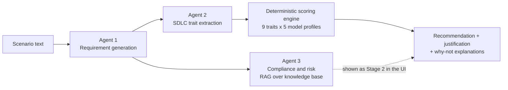
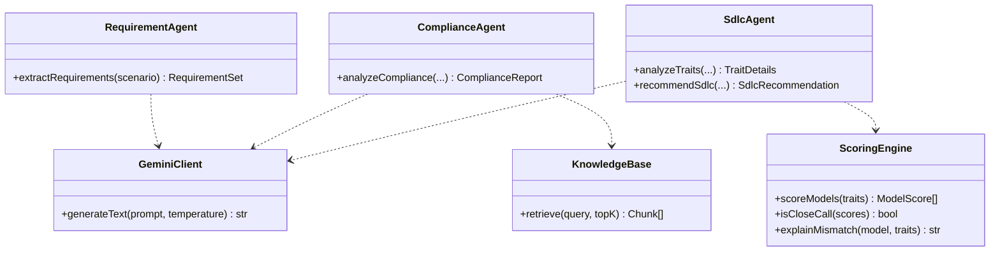

# Requora AI - Architecture and Design Notes

## Problem statement

Gathering software requirements and choosing the right SDLC model is manual and subjective, and it often ignores regulatory and risk constraints. Requora AI automates this: it generates structured requirements from a plain-language scenario, checks them against a compliance knowledge base using RAG, and recommends an SDLC model through deterministic, explainable scoring.

## Pipeline

In the UI the stages run as three separate calls: `/agents/requirements`, `/agents/compliance`, `/agents/sdlc`. `/agents/pipeline` runs all of them in one request for API testing.

Note: the compliance result is displayed to the user but is not currently fed into the SDLC trait extraction. Both agents work from the same requirement list. Feeding compliance findings into criticality/verification scoring is a possible future improvement.

## Responsibilities

| Component | File | Responsibility |
|---|---|---|
| Requirement agent | `app/agents/requirement_agent.py` | Scenario to functional and non-functional requirements with priority |
| Compliance agent | `app/agents/compliance_agent.py` | Retrieve relevant knowledge-base chunks, ground findings only in them, report risk level |
| SDLC agent | `app/agents/sdlc_agent.py` | Rubric-anchored trait extraction (with evidence), call scoring engine, write justification |
| Scoring engine | `app/agents/sdlc_rules.py` | Deterministic scoring of 5 SDLC models, close-call detection, why-not explanations |
| RAG | `app/rag/` | Gemini embeddings, ChromaDB ingestion and retrieval |
| Gemini client | `app/gemini_client.py` | Single place for model calls: retry on 503, fallback across models on 404/empty |
| API + UI | `app/main.py`, `app/static/` | FastAPI routes; single-page dashboard |

## Class diagram (logical)

## SDLC scoring methodology

1. The LLM rates the project on 9 traits (1-5) at temperature 0. It is given explicit rubric anchors for every trait and must cite evidence from the requirements (and from the original scenario text, which `/agents/sdlc` accepts as an optional `scenario` field) for each score. It does not choose the SDLC model.
2. Each model has a documented "ideal profile" over the same 9 traits. A model's compatibility score is `100 * (1 - weighted_distance / max_weighted_distance)`, where `weighted_distance = sum(weight[t] * |project[t] - profile[t]|)`. Every model is scored identically; there is no bonus for any model. (A test checks that each model scores exactly 100 on its own profile.)
3. The top model is recommended. Models are ranked on unrounded scores, never on the order the profiles are listed in. Two scores within 0.05 are a tie, broken by the smaller worst single-trait gap, then the smaller total unweighted gap, then alphabetical order; a tie is always a close call and the UI says so. If the runner-up is within 5.0 points the UI reports a close comparison instead of a decisive winner.
4. The LLM writes the justification from the measured scores and evidence, and is instructed never to contradict a score.
5. "Why not X?" text is generated by rules from the same distances, with no LLM call.

Why 9 traits: with only clarity, volatility, complexity and criticality, Spiral and V-Model had near-identical profiles and Spiral won most high-stakes scenarios. `risk_uncertainty` (novelty, not stakes) separates Spiral from V-Model; `verification_validation` separates V-Model from Waterfall; `stakeholder_feedback` separates Agile from Incremental; `incremental_suitability` and `prototyping_need` separate the iterative models from the rest.

### Profiles and weights (generated from `sdlc_rules.py`)

| Trait | Weight | Waterfall | V-Model | Incremental | Agile | Spiral |
|---|---|---|---|---|---|---|
| requirement clarity | 1.0 | 5 | 5 | 3 | 2 | 3 |
| requirement volatility | 1.2 | 1 | 1 | 3 | 5 | 3 |
| project complexity | 0.8 | 2 | 3 | 3 | 3 | 5 |
| project criticality | 1.0 | 2 | 5 | 2 | 2 | 5 |
| risk/uncertainty | 1.3 | 1 | 2 | 2 | 2 | 5 |
| verification & validation intensity | 1.1 | 2 | 5 | 2 | 1 | 3 |
| stakeholder feedback need | 1.2 | 1 | 1 | 3 | 5 | 2 |
| incremental delivery suitability | 1.0 | 1 | 1 | 5 | 5 | 2 |
| prototyping/experimentation need | 1.1 | 1 | 1 | 2 | 2 | 5 |

## Known limitations

- The compliance knowledge base is a small, curated set of paraphrased regulatory principles (31 chunks, 6 documents), not verbatim legal text. Cite it as a "curated compliance knowledge base".
- Trait scores come from an LLM, so they can vary between runs. The scoring that follows is deterministic.
- The relevance threshold (0.65) in the compliance agent was chosen empirically against ChromaDB's default L2 distance.
- No confidence percentages are shown, because none are computed.
